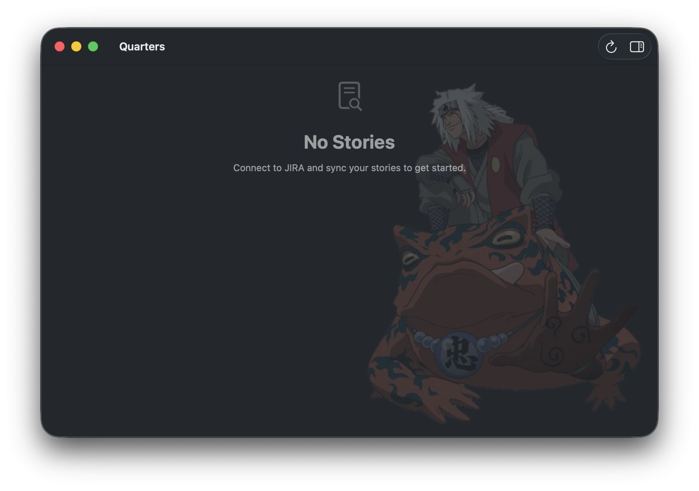

# Jiraiya

Jiraiya is a native macOS application that acts as a companion to Jira. It's designed to help visualize your work, focusing on outcomes and providing a clear overview of epics, stories, and progress across quarters and months.

- Syncs completed stories from a Jira Cloud project, using your email and an API token.
- Groups stories into outcomes you define, matched by keywords in titles and comments.
- Drill down from quarters to epics, months, and individual stories.
- Read-only. Jiraiya never changes your Jira issues. Stories are stored in a local database.

Requires macOS 15.5 or later and Apple Silicon.
